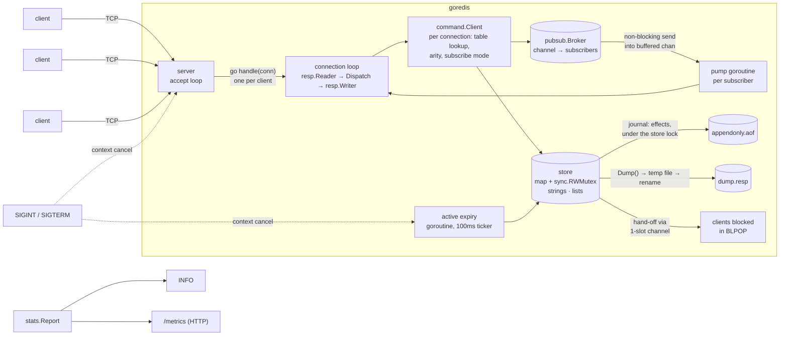

# goredis

[](https://github.com/AbhishekBasnet/goredis/actions/workflows/ci.yml)

A Redis-compatible key-value server written in Go, using only the standard library.

It speaks the Redis wire protocol (RESP2), so the real `redis-cli`, `redis-benchmark` and any Redis client library can talk to it. Strings, lists with blocking pops, expiry, pub/sub, an append-only file and snapshots, graceful shutdown, `INFO` and Prometheus metrics.


## Quick start

Requires Go 1.26 or newer (see `go.mod`).

```bash
make build                 # → bin/goredis
./bin/goredis -addr :6380  # default address is :6380
make race                  # every test, under the race detector
```

Or with Docker (a 17 MB distroless image, running as non-root):

```bash
docker build -t goredis .
docker run -p 6380:6380 -v goredis-data:/data goredis
```

`docker stop` sends SIGTERM, which triggers the graceful shutdown below; the data in `/data` survives a new container.

| Flag | Default | |
|---|---|---|
| `-addr` | `:6380` | listen address |
| `-dir` | `.` | where `appendonly.aof` and `dump.resp` live |
| `-appendonly` | `true` | log every write to the AOF |
| `-appendfsync` | `everysec` | `always`, `everysec` or `no` |
| `-maxclients` | `10000` | connection limit, `0` for none |
| `-timeout` | `0` | close clients idle this long (e.g. `5m`), `0` for never |
| `-shutdown-grace` | `5s` | how long shutdown waits for busy clients |
| `-metrics-addr` | off | serve Prometheus `/metrics` and `/debug/pprof`, e.g. `:9121` |

## Supported commands

| Group | Commands |
|---|---|
| Connection | `PING [message]`, `ECHO message` |
| Strings | `GET`, `SET key value [EX seconds \| PX milliseconds]`, `MGET`, `MSET`, `INCR`, `DECR` |
| Keys | `DEL`, `EXISTS`, `EXPIRE`, `TTL`, `PTTL`, `PERSIST` |
| Lists | `LPUSH`, `RPUSH`, `LPOP [count]`, `RPOP [count]`, `LLEN`, `LRANGE`, `BLPOP`, `BRPOP` |
| Pub/Sub | `SUBSCRIBE`, `UNSUBSCRIBE`, `PUBLISH` |
| Persistence | `SAVE`, `BGSAVE` |
| Server | `INFO [section ...]` |

Replies and error messages match Redis exactly, e.g. `ERR wrong number of arguments for 'get' command` and `WRONGTYPE` when a string command meets a list. Both RESP arrays and inline commands (`printf 'PING\r\n' | nc localhost 6380`) are accepted, and pipelining is supported.

## Performance

Measured with the real `redis-benchmark` against Redis 7.4 on the same laptop (50 clients). Full tables, method and caveats are in [`bench/results.md`](bench/results.md).

| | goredis vs Redis |
|---|---|
| No persistence, unpipelined | about 70–90% |
| No persistence, pipelined (`-P 16`) | roughly on par (69%–199% by command) |
| AOF `everysec`, pipelined writes | 72–169% |
| AOF `always` | 95–114% unpipelined, 108–244% pipelined |

- **Profiling found one big hotspot, and I fixed it.** The RESP parser spent 18% of CPU allocating three buffers per argument. Reading small arguments in place took a `SET` from 374 ns and 13 allocations to 157 ns and 4, and cut server CPU per request by 24% (pipelined) and 9% (unpipelined).
- **Group commit made the AOF 25× to 430× faster with `always`.** Before, every write did its own `write` and `fsync` under the global lock: about 700 writes/s whatever the load. Now writes go into a buffer, and one flusher goroutine writes and fsyncs each batch.

## Compatibility

`scripts/compat.sh` sends the same 79 commands through the real `redis-cli` to goredis and to Redis 7.4 and diffs the replies: they're byte-identical, error messages included. CI runs it on every push.

```bash
docker run -d --rm --network host redis:7.4-alpine redis-server --port 6390
./bin/goredis -appendonly=false &
make compat
```

## Architecture



```
cmd/goredis/      flags, wiring, signal handling, nothing else
internal/resp     RESP2 reader and writer; depends only on io.Reader/io.Writer
internal/server   TCP listener, one goroutine per connection, flush policy
internal/command  command table, per-connection Client, handlers
internal/pubsub   broker: channel → subscribers, slow-subscriber policy
internal/persistence  AOF writer and loader, atomic snapshots
internal/stats    counters and one Report for INFO and /metrics
internal/metrics  Prometheus text endpoint
scripts/          compat.sh (diff against Redis), bench.sh (redis-benchmark → CSV)
bench/results.md  benchmark tables and profiling notes
internal/store    data, locking, expiry
test/integration  real server on a random port, driven over TCP
```

Dependencies point one way: `server → resp, pubsub`, `command → resp, store, pubsub`. `server` doesn't import `command`. It declares the small `Session` interface it needs, `*command.Client` satisfies it, and `main` passes a one-line adapter closure that wires the two together.

## Design decisions

**One goroutine per connection.** Go's scheduler makes this cheap, and it keeps each connection's code a simple sequential loop. A slow client blocks only its own goroutine.

**Flush only when the input buffer is empty.** After each command the server checks whether more pipelined commands are already buffered. If so, it answers them before writing, so a batch of N commands costs one `write` syscall instead of N.

**Close the connection on a protocol error.** After malformed input there is no reliable way to find where the next command starts, so the server replies with the error and hangs up, as Redis does.

**A mutex, not a goroutine that owns the map.** A channel round trip per command costs more than an uncontended lock, and a `sync.RWMutex` lets reads run in parallel. Real Redis is single-threaded; this server isn't.

**One global lock, not shards.** It's the simplest correct choice, and each operation holds the lock for nanoseconds. Sharding is a planned experiment, to be measured with benchmarks first.

**The lock lives inside the store.** Every store method takes the lock once and does its whole job inside it. That makes `INCR` (read, parse, add, write) and `MSET` atomic. A handler that called `Get` and then `Set` would lose updates under concurrency, and the race detector would *not* catch it, because each access is locked. `TestConcurrentIncr` (100 clients) checks the exact final count.

**Lazy and active expiry, as in Redis.**
- *Lazy:* every command treats an expired key as missing. Reads hold only the read lock and can't delete it; writes can, and do.
- *Active:* lazy expiry alone would leave keys nobody reads in memory forever. A background goroutine wakes every 100ms, samples 20 keys from an index of keys that have a TTL, and deletes the expired ones. If more than 25% were expired it samples again, up to 16 rounds. The lock is taken once per round, so clients get a turn in between.
- The goroutine stops when its `context` is cancelled; `main` cancels it on SIGINT or SIGTERM and waits for it to return.

**Blocking pops hand values over; they don't wake clients to race for them.** A client in `BLPOP` on empty lists queues a waiter, with a 1-slot channel, on each key and waits in a `select` on that channel, a timer and its context. A push, still under the lock, pops the element and sends it straight to the longest-waiting client, removing that client from every queue first. Nobody is woken to compete for an element that someone else may already have taken, so an element can't be lost or delivered twice, and clients are served in FIFO order. `sync.Cond` was the alternative. It has no timed wait, and `Broadcast` wakes every waiter just so all but one can go back to sleep.

**A blocked client that hangs up leaves the queue.** Nothing reads the socket while `BLPOP` waits, so the connection starts a watcher goroutine that waits for the next byte. EOF cancels the command's context, which removes the waiter. Without this, the next push would hand its element to a dead connection.

**Typed values.** Each entry holds `any`: a `string` or a `*list`. A type assertion decides between returning the value and `WRONGTYPE`. Lists are ring-buffer deques: O(1) at both ends, and O(1) indexing for `LRANGE`. An empty list deletes its key, as in Redis.

**Pub/Sub: publishers never wait for subscribers.** Each subscriber has a buffered channel (1024 messages). `PUBLISH` does a non-blocking send to every subscriber of the channel. If one subscriber's buffer is full, that subscriber is disconnected, the same policy as Redis's pub/sub output-buffer limit, so one stalled client can't slow down the publisher or anyone else. Dropping messages silently was the alternative; disconnecting is louder, and the client can reconnect and resync.

**One writer at a time per connection.** A subscribed connection has two writers: the command loop (subscribe confirmations, `PING`) and a pump goroutine (pushed messages). A per-connection mutex serialises them, and each takes the lock around a whole reply, so their bytes never interleave. A separate goroutine waits for the "kicked" signal and closes the socket. That also unblocks a pump stuck writing to a client that stopped reading.

**The store writes the AOF, not the command layer.** Logging commands after they run has three bugs: two concurrent `SET`s can reach the file in the opposite order to the one the store applied; an element handed to a blocked `BLPOP` never shows up as removed; and `EXPIRE k 10` replayed tomorrow gives the key 10 more seconds. So every store mutation records its *effect* through a `Journal`, while still holding the store's lock: TTLs as absolute times (`SET k v PXAT ms`, `PEXPIREAT`), `INCR` as the `SET` of its result, a served `BLPOP` as an `LPOP`, and every removal of an expired key as a `DEL`, as Redis does. The AOF order is therefore exactly the order of changes. A model test runs thousands of random operations (with clock jumps and expiry), replays the journal into a fresh store, and requires an identical dataset.

**Replay is raw.** Loading applies journal entries straight to the data, ignoring expiry until it's done, because whether a key was alive was decided when the entry was written, not when it's replayed.

**AOF group commit.** Recording an entry, under the store lock, only appends its RESP encoding to an in-memory buffer and bumps a sequence number: no I/O. A flusher goroutine owned by the AOF swaps the buffer out, writes everything in it with one `write`, and with `appendfsync always` one `fsync`. Before flushing a batch of replies, a connection checks whether the sequence number moved while its commands ran. If it did, it waits until the flusher reports that sequence written (`no`, `everysec`) or synced (`always`). So a reply is still never sent before its entry reached the OS, and with `always` the disk: `kill -9` loses nothing acknowledged. While one fsync is in flight, every write that arrives joins the next batch, which is how `always` went from about 700 writes/s to Redis's level. With `everysec` a ticker fsyncs once a second. On startup, a last command cut off mid-write is detected and truncated away; corruption anywhere else refuses to start rather than guessing.

**Snapshots don't block clients.** `Dump()` copies the dataset as commands under a brief read lock; writing the file happens outside any lock (in a goroutine for `BGSAVE`). Writes go to a temp file, then `fsync`, `rename` over the old snapshot and `fsync` the directory, so a crash leaves either the old snapshot or the new one, never half of one. The snapshot format is the same RESP commands as the AOF, so both load through the same code. With the AOF on, it's the source of truth; when the AOF is first enabled on top of a snapshot, it's seeded from the snapshot.

**Graceful shutdown in a fixed order.** SIGINT/SIGTERM cancels one context. The server closes its listener, the cancellation wakes clients blocked in `BLPOP` (they get `(nil)`), and every connection gets a read deadline of "now", which wakes idle and subscribed clients. A command that's already running finishes and its reply is sent. Handlers check the context before every read, after setting their own deadline, so a handler can't re-arm a deadline that shutdown just set. `Run` returns only once every handler has exited; after a grace period (5 s), connections still busy are force-closed. Only then does `main` stop the expiry and fsync goroutines, wait for a running `BGSAVE` and close the AOF. So no write can race the AOF closing.

**Limits.** Over `-maxclients`, a new connection gets `-ERR max number of clients reached` and is closed, as in Redis. `-timeout` closes idle clients, but not subscribers or clients blocked in `BLPOP`, also as in Redis. A failing `Accept` (e.g. out of file descriptors) backs off from 5 ms up to 1 s and retries, instead of taking the server down.

**One source of numbers.** `INFO` and `/metrics` both render the same `stats.Report`, collected from atomic counters (connections, commands) and the store and broker (keys, blocked clients, subscribers), so they can never disagree.

**Testable time.** The store reads the time through a `now func() time.Time` field. Expiry unit tests swap in a fake clock and move it forward, so they're exact and never sleep.

## Testing

```bash
make race                                                   # unit + integration, -race
go test -fuzz=FuzzReadCommand -fuzztime=1m ./internal/resp  # fuzz the protocol parser
```

- **Unit:** table-driven tests for the RESP reader and writer, every command and every error message, and the store.
- **Partial reads:** the reader is tested with `iotest.OneByteReader`, the worst possible TCP fragmentation.
- **Fuzz:** random input must never panic, and anything accepted must survive an encode → parse round trip.
- **Concurrency:** 100 goroutines (store) and 100 TCP clients (integration) `INCR` one key; the count must be exact.
- **Producers/consumers:** many pushers and many `BLPOP` consumers, in-process and over TCP; every element must arrive exactly once.
- **Pub/Sub:** fan-out to 20 subscribers over TCP in order; a subscriber that never reads is disconnected while publishers keep going; subscriptions disappear when the connection does.
- **Persistence:** journal replay against a model (1M random ops checked); every truncation point of an AOF recovers a clean prefix; the real binary is restarted with clean shutdown and `kill -9`, with a served `BLPOP`, a truncated tail, a corrupt file, snapshots only and switching from snapshots to the AOF.
- **Group commit:** 100 concurrent writers with a deliberately slow fsync share fewer than 20 fsyncs; `always` waits for the fsync and `everysec` doesn't; a failed write or `Close` never leaves a waiter hanging; replies wait for durability, a pipelined batch waits once, and read-only batches don't wait; `kill -9` under 16 concurrent writers keeps every acknowledged write, for each fsync policy.
- **Lifecycle:** shutdown wakes idle, blocked and subscribed clients; waits for a command in progress; force-closes after the grace period; client limit and idle timeout; no goroutine leaks after many connect/disconnect cycles; SIGTERM under write load keeps every acknowledged write.
- **Model test:** the ring buffer is checked against a plain slice over 10,000 random operations.
- **Integration:** a real server on port 0, driven over TCP with raw RESP, including a 1000-command pipeline.
- **Compatibility:** 79 commands diffed against real Redis through `redis-cli` (`make compat`).
- **Benchmarks:** `make bench` for the parser, writer, store and dispatch; `scripts/bench.sh` for `redis-benchmark`.

CI (`.github/workflows/ci.yml`) runs gofmt, vet, the race-enabled tests, 30 s of fuzzing, the compatibility diff against a Redis service container, and the Docker build.

## Status

| Stage | |
|---|---|
| TCP server, RESP protocol, pipelining | ✅ |
| Command registry, string commands | ✅ |
| Expiry (lazy + active) | ✅ |
| Lists and blocking `BLPOP` | ✅ |
| Pub/Sub | ✅ |
| Persistence (AOF, snapshots) | ✅ |
| Graceful shutdown, client limits, `INFO`, metrics | ✅ |
| Benchmarks against real Redis, profiling, Dockerfile, CI | ✅ |
| Stretch: AOF group commit | ✅ |

## Known differences from Redis

- `SET` supports `EX` and `PX` only, not `NX`, `XX`, `GET`, `KEEPTTL`, `EXAT` or `PXAT`.
- `EXPIRE` doesn't accept the Redis 7 `NX`/`XX`/`GT`/`LT` flags.
- TTLs are capped at about 292 years (the range of `time.Duration`).
- `COMMAND` and `CONFIG` aren't implemented. `redis-cli` asks for `COMMAND` on startup and `redis-benchmark` for `CONFIG`; both carry on after the error.
- No `INCRBY`, `DECRBY`, `APPEND`, `STRLEN`, `GETSET`, `KEYS`, `SCAN`, `FLUSHALL`.
- No `LINSERT`, `LSET`, `LREM`, `LTRIM`, `LINDEX`, `BLMOVE`.
- A client blocked in `BLPOP` that sends more commands before hanging up is noticed only when the `BLPOP` returns.
- No pattern subscriptions (`PSUBSCRIBE`), sharded pub/sub, `PUBSUB` introspection, `QUIT` or `RESET`.
- `PUBLISH` counts only subscribers that accepted the message; one that was just disconnected for being slow isn't counted.
- The AOF grows forever: no `BGREWRITEAOF`. Snapshots aren't taken automatically (no `save 60 1000` rules), and there's no `LASTSAVE`.
- The snapshot format is RESP commands, not Redis's binary RDB.
- `INFO` has fewer fields than Redis's, and `used_memory` is the Go heap, not RSS.
- A command that ignored its context and never returned would hold up shutdown; every real command waits only on the network or on `BLPOP`, both of which shutdown interrupts.
- Write errors on the AOF are logged and stop further logging; Redis would refuse writes (`MISCONF`) instead.
