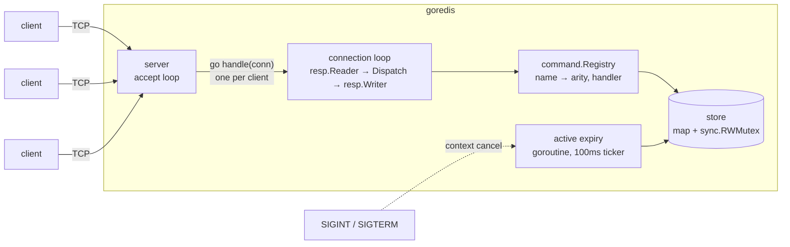

# goredis

A Redis-compatible key-value server written in Go, using only the standard library.

It speaks the Redis wire protocol (RESP2), so the real `redis-cli`, `redis-benchmark` and any Redis client library can talk to it.

```console
$ make run
$ redis-cli -p 6380
127.0.0.1:6380> SET session:42 alice EX 60
OK
127.0.0.1:6380> GET session:42
"alice"
127.0.0.1:6380> TTL session:42
(integer) 60
127.0.0.1:6380> INCR visits
(integer) 1
```

## Quick start

Requires Go 1.26 or newer (see `go.mod`).

```bash
make build                 # → bin/goredis
./bin/goredis -addr :6380  # default address is :6380
make race                  # every test, under the race detector
```

## Supported commands

| Group | Commands |
|---|---|
| Connection | `PING [message]`, `ECHO message` |
| Strings | `GET`, `SET key value [EX seconds \| PX milliseconds]`, `MGET`, `MSET`, `INCR`, `DECR` |
| Keys | `DEL`, `EXISTS`, `EXPIRE`, `TTL`, `PTTL`, `PERSIST` |

Replies and error messages match Redis exactly, e.g. `ERR wrong number of arguments for 'get' command`. Both RESP arrays and inline commands (`printf 'PING\r\n' | nc localhost 6380`) are accepted, and pipelining is supported.

## Architecture



```
cmd/goredis/      flags, wiring, signal handling, nothing else
internal/resp     RESP2 reader and writer; depends only on io.Reader/io.Writer
internal/server   TCP listener, one goroutine per connection, flush policy
internal/command  command table and handlers
internal/store    data, locking, expiry
test/integration  real server on a random port, driven over TCP
```

Dependencies point one way: `server → resp`, `command → resp, store`. `server` doesn't import `command`; it declares a one-method `Dispatcher` interface, and `main` wires the two together.

## Design decisions

**One goroutine per connection.** Go's scheduler makes this cheap, and it keeps each connection's code a simple sequential loop. A slow client blocks only its own goroutine.

**Flush only when the input buffer is empty.** After each command the server checks whether more pipelined commands are already buffered. If so, it answers them before writing, so a batch of N commands costs one `write` syscall instead of N.

**Close the connection on a protocol error.** After malformed input there is no reliable way to find where the next command starts, so the server replies with the error and hangs up, as Redis does.

**A mutex, not a goroutine that owns the map.** A channel round trip per command costs more than an uncontended lock, and a `sync.RWMutex` lets reads run in parallel. Real Redis is single-threaded; this server isn't.

**One global lock, not shards.** It's the simplest correct choice, and each operation holds the lock for nanoseconds. Sharding is a planned experiment, to be measured with benchmarks first.

**The lock lives inside the store.** Every store method takes the lock once and does its whole job inside it. That makes `INCR` (read, parse, add, write) and `MSET` atomic. A handler that called `Get` and then `Set` would lose updates under concurrency, and the race detector would *not* catch it, because each access is locked. `TestConcurrentIncr` (100 clients) checks the exact final count.

**Lazy and active expiry, as in Redis.**
- *Lazy:* every command treats an expired key as missing. Reads hold only the read lock and can't delete it; writes can, and do.
- *Active:* lazy expiry alone would leave keys nobody reads in memory forever. A background goroutine wakes every 100ms, samples 20 keys from an index of keys that have a TTL, and deletes the expired ones. If more than 25% were expired it samples again, up to 16 rounds. The lock is taken once per round, so clients get a turn in between.
- The goroutine stops when its `context` is cancelled; `main` cancels it on SIGINT or SIGTERM and waits for it to return.

**Testable time.** The store reads the time through a `now func() time.Time` field. Expiry unit tests swap in a fake clock and move it forward, so they're exact and never sleep.

## Testing

```bash
make race                                                   # unit + integration, -race
go test -fuzz=FuzzReadCommand -fuzztime=1m ./internal/resp  # fuzz the protocol parser
```

- **Unit:** table-driven tests for the RESP reader and writer, every command and every error message, and the store.
- **Partial reads:** the reader is tested with `iotest.OneByteReader`, the worst possible TCP fragmentation.
- **Fuzz:** random input must never panic, and anything accepted must survive an encode → parse round trip.
- **Concurrency:** 100 goroutines (store) and 100 TCP clients (integration) `INCR` one key; the count must be exact.
- **Integration:** a real server on port 0, driven over TCP with raw RESP, including a 1000-command pipeline.

## Status

| Stage | |
|---|---|
| TCP server, RESP protocol, pipelining | ✅ |
| Command registry, string commands | ✅ |
| Expiry (lazy + active) | ✅ |
| Lists and blocking `BLPOP` | next |
| Pub/Sub | planned |
| Persistence (AOF, snapshots) | planned |
| Graceful shutdown, client limits, `INFO` | planned |
| Benchmarks against real Redis, Dockerfile | planned |

## Known differences from Redis

- `SET` supports `EX` and `PX` only, not `NX`, `XX`, `GET`, `KEEPTTL`, `EXAT` or `PXAT`.
- `EXPIRE` doesn't accept the Redis 7 `NX`/`XX`/`GT`/`LT` flags.
- TTLs are capped at about 292 years (the range of `time.Duration`).
- `COMMAND` isn't implemented. `redis-cli` asks for it on startup, gets an error and carries on.
- Data lives in memory only, for now.
